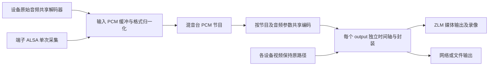

# 混音台统一音频配置与设备输出接入 spec

> 混音台集中管理音频输入及输出格式，将混音结果送入每个设备的媒体输出；按音频内容共享混音和编码，避免按 output 重复处理。

状态：实施中，2026-10-13。

本文的 output 指完整媒体输出目的地；同一 ZLM `Media` 的 RTSP、FLV、HLS 共用一条节目音轨。内部视频、音频轨道不是两个独立目的地。

## 1. 目标和已经明确的约定

- 混音台设置之后，音频进入每个设备的每个媒体输出目的地，包括经 ZLM 分发的实时流及其录像、直接网络推流和文件输出。
- 输入增益、静音、左右声道映射，以及节目音频的编码、采样率、声道数、码率均在混音台设置。设备侧不重复设置这些音频处理参数，保留视频参数和输出目标。
- 端子音频必须支持左右声道独立传输；不能以“两声道 WAV 有数据”替代真实的声道隔离验收。
- 已运行设备、后加入设备、设备断流重连都执行相同的音频策略。一个慢 output 不阻塞混音台和其他直播 output。
- 不因增加音频而解码、重编码原本可以 stream-copy 的视频。

“每个 output”指完整的媒体输出目的地，不是给内部视频帧消费者塞入音频。当前 `zlm_outputs()` 的视频、音频两个 `OutputConfig` 是同一个 ZLM `Media` 的两条轨；检测、预览等 `RawFrame` 视频订阅不是混音目标。经 ZLM 同一 `Media` 分发的 RTSP、FLV、HLS 复用同一条节目音轨，不按协议重复编码。

## 2. 当前实现与缺口

| 当前事实 | 代码证据 | 对新用途的影响 |
| --- | --- | --- |
| 混音台选取设备音频，生成独立输出总线 | `nvr/src/audiomixer/mod.rs`、`crates/nvr-audio-mixer/src/lib.rs` | 当前发布到 `/mixer/{bus}`，没有注入设备 output |
| 混音台输入从 ZLM 本机 RTSP 重新拉取、解码 | `device_audio_url()`、`AudioSource::start()` | 在已有设备管线能提供 PCM 时，存在重复封装、取流和解码 |
| 每个 MixBus 固定 48 kHz、双声道、AAC 128 kbps，并单独编码、发布 | `crates/nvr-audio-mixer/src/bus.rs` | 尚无用户可设的全局音频格式，也没有共享编码包接口 |
| 设备音频转码参数在 `device.config.output`，设备启动时映射到管线 | `nvr/src/device_output.rs`、`nvr/src/manager.rs` | 当前设备输出和混音台配置是两条独立路径 |
| Pipe 已能订阅输入的共享音频解码器 | `Pipe::subscribe_audio()`、`Bus::subscribe_audio_internal()` | 可作为设备原音输入，不必从处理后的设备输出回拉 |
| 构建 output 先查找原输入对应音轨 | `Bus::build_output()` | 无音轨的视频输入当前不能仅靠改 `include_audio` 添加外部节目音轨 |
| GB28181、小米采用原生转发路径 | `architecture.md`、`device_output::validate()` | 必须单独接入，不能把普通 Pipe 改完视为全设备完成 |
| 一个 sink 结束会使整个 Pipe 会话拆除 | `media-pipe-core/src/pipe.rs`、`design-media-pipe.md` | 要区分源 EOF 和单 output 故障，才能保证故障输出隔离 |

基线核查：`cargo test -p nvr-audio-mixer --lib` 的 1 个测试、`cargo test -p ffmpeg-bus --lib audio_mixer_test` 的 6 个测试通过。这些覆盖既有编码时间基与混音控制/PCM 运算，不证明设备 output 注入或多路性能已经通过。

## 3. 最终音频内容决定共享范围

已确认两种模式都需要，由 Web 混音台设置选择。配置必须显式指定下列模式：

| 模式 | 每个设备的最终音频 | 混音/编码共享范围 |
| --- | --- | --- |
| `program`，性能优先推荐 | 全部使用混音台节目音轨；需要的设备原音在混音台作为输入选择 | 同一节目和编码参数只混音、编码一次，所有 output 共享 |
| `add_original` | 混音台所选输入与该设备原音组成最终混音 | 不同设备内容通常不同；按设备混音、编码，同设备的多个 output 共享 |

`program` 是性能优先选项；`add_original` 同样集中配置参数，但不能承诺跨设备共享一次编码。

`add_original` 的贡献源按原始 `source_id` 去重：若该设备已经是混音台节目输入，最终只使用一次，采用混音台的增益/静音设置，不再额外叠加设备原音。若设备不是节目输入，才额外加入其原音。必须在未饱和的累加阶段去重，不先裁剪节目 PCM 再相减。

## 4. 推荐数据路径

上图为 `program`。`add_original` 在格式归一化之后形成每设备的贡献源集合，同设备同音频配置的 output 共用编码器。每个 tick 只从各源缓冲取样一次，按公共时钟对齐，先计算未裁剪的节目累加值，再为未在节目中的设备原音增加一份贡献、独立裁剪。这样不必为每设备重复遍历全部节目源，PCM 加法成本可从约 D×S 降为 S+D；不能使用“已裁剪节目相减”的近似。

性能关键是共享进程内 PCM 和编码包，不是让每个 output 拉取 `/mixer/{bus}` 再解码。现有独立发布流保留为试听出口，作为同一共享编码器的一个消费者。

### 输入与回授隔离

- 普通 Pipe 设备优先订阅原始输入的 `subscribe_audio()`，复用已有解码器；已有 ASR 订阅不应触发第二个音频解码器。
- 输入池按源标识和源会话代次管理。一个设备重连只替换该源，重新订阅；不得一直保留已经 EOF 的 receiver。
- 端子由一个可取消、可 join 的采集任务打开 `hw:CARD=rockchipes8388,DEV=0`，共享采集结果；按卡名发现设备，不能固定卡号。
- 输入格式从实际流头获得并自动转换，用户不必填写每台设备原始音频的采样率或编码。对确实需要协商参数的采集设备，输入打开参数集中存入混音台对应源配置。
- 混音输入只能来自未注入节目音轨的原始音频。禁止使用已经混过的设备输出作为输入，否则形成音频回授。不能仅靠“source_id 不等于 bus_id”检查回授。
- 没有公共 Pipe PCM 的原生设备可以暂用**原始流**本机 RTSP 接入，但每源最多拉取/解码一次；这是原生适配过渡路径，普通 Pipe 不走该路径。

### PCM 与编码

- 首版内部统一使用现有混音器的 S16 双声道表示，复用已有增益和 i32 累加；最终输出前只做一次饱和裁剪，记录 clipping。
- 重采样、声道转换按源和目标工作格式复用，不按 output 重建。源格式变化时重建该源的转换器。
- 输入缓冲以时间限制容量；先用现有 1024 samples 帧长作为基线。48 kHz 下约 21.33 ms，不能把这一数值当作端到端延迟。
- 公共工作格式首版固定为 48 kHz、S16、双声道，与输出 profile 分开；每个 profile 最多做一次最终采样率/格式转换。不同编码器需要的输入帧长由该 profile 的有界 FIFO 适配，不假定 AAC/Opus 都接受 1024 samples。
- 编码缓存键必须包含音频内容标识（节目/设备、策略版本、媒体会话代次）及完整音频参数。两个内容不同的设备不能仅因 AAC 参数相同而共享编码器。
- `program` 下一个节目、一个编码 profile 对应一个编码器。若协议确实要求不同编码，只为不同 profile 新建编码器；不为不同视频分辨率、output ID、设备 ID 重复编码相同节目。
- 复用 `RawPacket` 的引用计数包；修改每个 output 的包头/PTS 前创建独立 packet 引用，不改共享 payload。当前 `RawPacket::data()` 会复制字节，因此此分发层不应把它当作无拷贝接口。

FFmpeg 的 [`av_packet_clone`/`av_packet_ref`](https://ffmpeg.org/doxygen/trunk/group__lavc__packet.html) 可以引用同一压缩数据，时间基转换由 `av_packet_rescale_ts` 处理；容器封装、网络发送和现有 sink 的数据转换仍可能发生拷贝，不声称全链路零拷贝。

## 5. 设置归属与接口

混音台配置分为三部分：

| 配置 | 设置位置 | 约定 |
| --- | --- | --- |
| 源选择、输入增益、静音、左右声道映射 | 混音台输入条 | 源原始编码/采样率自动识别 |
| codec、sample_rate、channels、bitrate | 混音台节目音频 | 对所有绑定输出生效；首选 AAC、48 kHz、双声道、128 kbps |
| enabled、mode、active_bus_id | 混音台全局分发 | 第一版显式选择一个节目总线用于全设备分发，其他总线可继续试听 |
| 分辨率、帧率、视频编码、视频码率、输出地址 | 设备/output | 保持设备独立配置 |
| use_global_audio | 每个 output | 默认使用；关闭时保留该 output 的原音路径 |

本轮 profile 的 `channels=2`，左右声道映射不得自动合并。单声道输出仅在明确接受下混的后续需求中开放，不纳入“左右独立传输已通过”的结论。

建议新增 `/api/audiomixer/config` 的 GET/POST，沿用 API 鉴权与统一 `BaseResponse`。提交用完整配置和版本号；响应返回配置版本、实际状态、受影响输出、未就绪源与错误，不把“已存入 KV”当作“所有输出已生效”。输入值和协议编码兼容性在启动工作任务之前验证。

原来的 bus/input 增删、增益、静音接口继续使用。运行模式/绑定以及音频 profile 需要持久化，启动时先创建混音服务状态，再让设备输出获得订阅；某个输入未上线不阻止视频设备启动。

旧设备 `config.output` 中的音频参数在关闭全局混音时维持原行为。开启全局混音时由混音台 profile 唯一决定音频格式，设备 UI 隐藏重复编辑项、显示有效参数来自混音台；旧客户端提交冲突音频覆盖值应报明确校验错误，不能静默忽略。旧多种音频参数不能随便选第一台迁为全局值，启用时由用户明确提交节目 profile。

已确认 `include_audio=false` 只表示不使用设备原音，不阻止节目音轨注入。新增 output 的 `use_global_audio` 控制是否接入全局混音：未设置视为 true；全局混音关闭或该开关为 false 时走原音路径，原音仍受 `include_audio` 控制。`program` 下接入输出只使用节目音轨；`add_original` 下接入输出仅在 `include_audio=true` 时叠加设备原音。该 output 不使用全局混音时，不影响其他 output。Web 页面明确显示每个 output 的选择与实际生效状态。

## 6. 时间轴、丢包与格式切换

- 节目音频使用单调时钟与样本数生成 PTS；不用系统墙上时间。不能把节目运行时长直接写进新设备从零开始的视频时间轴。
- 每个 output 将节目时钟与视频的播放时间轴建立映射，转换 time base，保持相对时差和单调 DTS。视频带 B 帧时保留 PTS/DTS 区别；音频 priming 的处理按容器约束执行，不能全局把负 PTS 简单截成 0。
- 时间基缩放不解决两个采集时钟的漂移。源缓冲和时钟映射需要估计 drift，采用有界重采样补偿/补静音/丢旧样本；测量对齐误差。FFmpeg 的[重采样文档](https://ffmpeg.org/ffmpeg-resampler.html)提供补偿机制，但参数和容差须在台架验证。
- 新 output 订阅最新节目包，从可播放的视频边界开始并建立新映射。设备重连更新映射和源代次，不重启所有设备。
- 直播消费者各有有界队列和丢包统计；慢 output 超限后丢弃旧音频、恢复到当前时钟，不回压公共混音服务。需要重新同步的视频输出等关键帧再恢复。单 output 故障不得当作源 EOF 拆除其他正常 output，需修改当前 Pipe 的结束判定。
- 录像/文件消费者在队列预算内保留全部包；写出速度长期跟不上、超过预算时显式报告该输出失败/录制缺口，关闭受影响输出，不暗中丢音频后仍宣称无损。共享实时节目不能同时保证“任意慢磁盘、有限内存、无限期无损且不影响其他消费者”；磁盘持续吞吐必须纳入验收。ZLM HLS 归档仍按既有分片链路，验证其实际节目音轨与缺口记录。
- 未启用实时节目的普通文件处理继续遵守既有无损策略；启用共享实时节目时，文件视频输入必须按播放 PTS 实时推进，结束时关闭对应 output，不让公共音轨使文件永久不结束。快于实时的离线导出不能直接绑定现场节目，需另有可重放音频输入，不在首版范围。
- 增益、静音、源加入/退出在帧边界生效，不重启视频。修改音频 codec/采样率/声道/extradata 视为媒体格式变更：以新配置代次创建完整轨道描述，在所有目的地协商切换；需要重建 Media 的 output 允许短暂重连，不能把新编码包写入旧轨道。先验证和准备编码器；同名 Media 必须先停旧生产者、join、释放旧媒体，再注册新媒体，遵守 manager 的生命周期约束，不同时注册两个同名 Media。失败时报告状态并按旧有效配置重建，回滚也可能短暂断流。
- 配置状态区分 requested 和各 output 的 effective 版本，只有全部目标应用成功才报告全局生效；部分失败可追踪并回滚，不能把跨网络目的地的切换伪装成单个原子操作。
- 丢失一个源时将其贡献置为静音并重连。公共节目全部丢源时 `program` 输出静音，`add_original` 保留可用设备原音；不得未经设置回退到另一个隐私音源。

## 7. 修改边界

| 模块 | 拟修改内容 |
| --- | --- |
| `ffmpeg-bus` | 输出音频可以来自外部共享 PCM/编码包，而非必须来自原输入音轨；复用解码器/编码器、接入时间轴及消费者背压策略 |
| `media-pipe-core` | 增加不含 ZLM 类型的节目音频订阅/绑定；无原音的视频输入也能创建外部音轨；区分源结束与单输出故障 |
| `media-pipe-zlm` | 用实际节目 codec metadata 建轨；coordinator 的 expected 包含实际外部音轨，处理注册失败与格式切换 |
| `nvr-audio-mixer` | 将节目生成和 RTMP 发布拆开；对外只提供配置/订阅/停机，小接口隐藏源重连、缓冲、混音与编码共享 |
| `nvr/src/audiomixer` | 配置持久化、源解析、全设备绑定、状态与 API；本地端口从现有 `NVR_ZLM_*_PORT` 配置获取 |
| `manager`、直播、原生设备桥 | 设备创建和重连时获取同一全局策略；补齐 GB28181、小米的原始源与最终输出分离 |
| dashboard | 混音台统一格式编辑和状态；设备显示继承参数，试听与设备输出复用同一节目 |

新增任务都必须保留 cancel 和 JoinHandle。关停顺序是停止采集/节目生产及订阅消费者，等待 join，再释放设备媒体与 ZLM。现有 `MixBus::Drop` 只发取消信号、发布任务句柄未保留，不能直接拿现状保证同步关停。

GB28181/小米不能在 ZLM 已发布原始 Media 上直接额外追加第二条音轨。需要保留未混音原始源，构建独立最终媒体输出，视频尽量原包转发，音频接节目；确认现有 URL、回放和录像契约，不能为了避开接入而让原生设备漏混音。实施分阶段完成，但覆盖原生路径之前不宣布“每个设备”完成。

## 8. 性能成本与取舍

设 S 为原始音频源数，D 为设备数，O 为逻辑输出数，K 为不同节目音频编码 profile 数；第一版一个节目、统一 profile 时 K=1。

| 方案 | 采集/解码 | PCM 混音 | 音频编码 | 随 O 增长的成本 |
| --- | --- | --- | --- | --- |
| 每个 output 回拉并混音 | 最坏 O×S | O 份 | O 份 | 重复取流、转换、编码、封装 |
| `program` 共享节目 | 每个源一次，共 S 份 | 每个节目一次 | K 份 | 包引用、时间戳映射、封装和发送 |
| `add_original` 按设备共享 | 每个源一次 | 通常 D 份，复用归一化输入 | 最坏 D×K 份 | 同设备 output 的包引用和封装 |

先消除重复取流/解码/编码，再优化混音循环分配。复用 acc/混音帧缓冲，批量读写 PCM，保持增益/静音热路径无控制面锁；不要在每个包上查数据库或设备列表。现在混音循环每帧分配 acc、各输入帧和结果，可在正确性基线建立后替换为可复用缓冲。

48 kHz、双声道 S16 PCM 的裸数据率为 `48000×2×2=192000 B/s`。这是数据量推算，不是 CPU 或端到端内存基准；底层缓冲、分配器、编码器和封装还有开销。AAC 128 kbps 的压缩载荷约 16000 B/s，不代表包含容器、协议的实际网络流量。

推荐从一个节目、一个全局 profile 开始，不提前引入无限 profile 缓存。确有协议差异再扩为有限 profile 集合。任何“CPU 降低多少”“16 路可以稳定运行”的结论都需台架基准，不能从上述实例数推断。

## 9. 实施步骤与验收

1. 明确最终音轨模式及旧音频开关语义；冻结配置/API，写原始 PCM 和注入 output 的失败测试。
2. 将节目生成与独立 RTMP 发布分离，提供共享 PCM/编码包订阅；同一源解码和同一节目 profile 编码只创建一次。
3. 接入普通 Pipe、File/Net 和 ZLM 输出，包括无原音设备；先以确定性信号验证实际媒体文件和拉流内容。
4. 实现 GB28181/小米适配、源断连恢复、格式变更切换及取消/join；保留原始源与输出的独立性。
5. 迁移 dashboard 设置并进行真机回环、多设备、录像和性能回归。

验收至少覆盖：

- 全局源左路 1 kHz、右路 1.5 kHz；各设备原音用不同频率。分别解码每个实际 output，核对混入/替换模式、左右声道、增益、静音、是否重复贡献；监听独立 `/mixer` 流不算通过。
- 至少两个设备各两个逻辑 output；包括已运行、后新增、设备重连、无原音输入、显式静音输出；测试输出集合与预期完全一致。
- 混音台来源设备的输出也加入节目，同时输入仍来自原始流；持续运行不出现反馈放大。移除源、修改音量不导致视频重启。
- 视频 stream-copy 时检查视频编码器实例仍为零；原有设备视频输出参数继续有效。
- AAC 和 Opus 等已支持 profile 的真实音轨 metadata、编码、采样率、声道正确；切换格式后没有新包进入旧 codec 的轨道。
- 网络慢消费者/断流单独恢复，其他直播 output 不受阻；录像没有未声明的丢帧。
- GB28181 与小米各至少一条真实或受控原生源，验证节目进入最终流及录像，原始流不会回授。
- 端子回环按卡名定位且单次打开；16/44.1/48 kHz 源自动转换、左右独立。现有测试发现的差分路由必须在台架准备中明确，不能默认配置为立体声。
- 设备数 1/2/4/8/16、每设备 output 数 1/2/4，固定视频输入和音频源/profile，比较关闭/启用、`program`/`add_original`；记录 CPU、RSS、decoder/encoder 实例数、采集打开次数、队列深度、丢包、音画误差和切换恢复时间。
- `program` 下同一源数与 profile 数时，O 增长不能增加节目解码/重采样/混音/编码实例；`add_original` 下同一设备增加 O 不能增加该设备混音/编码实例。实例上限是结构验收，不等于 CPU 完全不增长。
- 时间轴含非零起点、不同 time base、B 帧、重连、模拟采样时钟漂移；建议 60 分钟持续运行音画误差 ≤100 ms，作为待台架确认的验收目标；测试必须区分节目公共延迟和设备自身原有延迟。
- 停机后所有生产任务已 join，资源不再增长；设置持久化、启动恢复以及配置应用失败的旧版本保留可验证。

## 10. 已确认的业务选择

1. `program` 和 `add_original` 都实现，按混音台 Web 页面选择。
2. `include_audio=false` 表示不使用设备原音，全局节目仍注入。
3. 每个 output 可通过 `use_global_audio` 决定是否使用全局混音，默认使用。

音频参数集中在混音台；不同模式和 output 选择分别验证混音实例数、原音保留与实际媒体内容。
