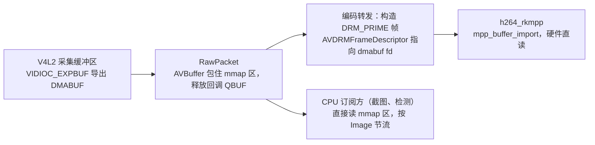

# V4L2 采集 DMABUF 直通 RKMPP 编码 spec

> Rockchip 构建下，HDMI/MIPI 采集缓冲区以 DMABUF 直接交给 RKMPP 硬件编码，CPU 不再拷贝或读取像素；现有 FFmpeg V4L2 采集路径完整保留，作为非 Rockchip 构建的唯一路径和 Rockchip 下的回退路径。

状态：已实现，默认关闭（`NVR_V4L2_DMABUF=1` 开启），20 主机验收进行中，2026-10-15。

## 1. 目标和已经明确的约定

- 只在 `rockchip` feature 下编译和启用新路径；非 Rockchip 构建的代码和行为完全不变。
- 现有路径（FFmpeg `v4l2` 输入 → rawvideo 包 → 零拷贝帧 → RKMPP 编码）保留，不删除、不改语义。新路径不可用时自动回退到它，并在日志中写明原因。
- 对上层透明：设备配置、Pipe/Bus 接口、ZLM 输出、录像、截图、检测、解码分级订阅（`FrameDemand`）照常工作。
- 视频直接转发和非 V4L2 输入不受影响。

## 2. 现状与测量

20 主机（RK3588）两路 1080p60 HDMI 采集并硬编码，2026-10-15 已做的优化把 nvr CPU 从约 453% 降到约 126%（单核百分比），见 `docs/memory/media-and-recording.md`。剩余开销中与采集直接相关的部分：

| 开销 | 位置 | 约占单核 | 原因 |
| --- | --- | --- | --- |
| 读帧拷贝 | `av_read_frame` → FFmpeg `libavdevice/v4l2.c` | hdmi2（BGR24）约 60%、HDMI 1（NV12）约 10% | FFmpeg 每帧把 DMA 缓冲区 memcpy 到新包（含缺页清零）；FFmpeg 命令行单独读 `/dev/video11` 也是如此（0.61 核），属于这版 FFmpeg + 驱动的固有行为 |
| 编码导入拷贝 | `avcodec_send_frame` → `av_hwframe_transfer_data` | 约 20% | rkmpp 编码器收到 CPU 帧时先拷进自己的 DMA 缓冲区 |

两次拷贝合计约 0.9 核。DMA 内存对 CPU 来说读取慢，单纯改 FFmpeg 为零拷贝只会把开销转移到编码导入；只有让硬件直接读采集缓冲区，才能同时消掉两次拷贝。

设备与驱动（板上实测）：

| 设备 | 驱动 | 接口 | 格式 | 每行字节 | 缓冲区数（FFmpeg 申请后） |
| --- | --- | --- | --- | --- | --- |
| hdmi2 `/dev/video11`（`stream_hdmirx`） | `rk_hdmirx` | 单平面 multiplanar | BGR3（BGR24） | 5760 | 41 |
| HDMI 1 `/dev/video0`（`stream_cif_mipi_id0`） | `rkcif` | 单平面 multiplanar | NV12 | 1920 | 64 |

板上 RK FFmpeg 的 `libavcodec` 含 `mpp_buffer_import_with_tag`，rkmpp 编码器支持 `drm_prime` 输入（`ffmpeg -h encoder=h264_rkmpp` 列出 `drm_prime`）。

## 3. 目标数据路径

- 采集缓冲区在整个链路中不被 CPU 拷贝；编码器通过 fd 导入，硬件读取。
- 包仍是现有的 `RawPacket`（rawvideo），所以输入广播、订阅、指标和现有消费方不需要改。包的数据指针指向 mmap 区，CPU 消费方（截图、检测、软件编码回退）照常能读，只是读 DMA 内存较慢；它们本来就按 `FrameDemand::Image` 节流。

## 4. 设计

### 4.1 模块与选择

- 新增 `crates/ffmpeg-bus/src/v4l2_dmabuf.rs`，整体 `#[cfg(feature = "rockchip")]`。负责打开设备、REQBUFS/mmap、EXPBUF、QBUF/DQBUF、STREAMON/OFF，产出与 `AvInput` 同样的 `streams()` 描述和 `RawPacket`。ioctl 封装优先复用工作区已有依赖（`rustix` 或 `tokio-linux-video`），确认它们能否覆盖 multiplanar 和 EXPBUF；不能时用最小的 `libc` ioctl 封装，不引入第二套 V4L2 库。
- 选择在 `Bus::prepare_input_task` 里完成，输入为 `InputConfig::Device { format: "v4l2" }` 时依次判断，全部满足才走新路径，否则用现有 `AvInput::open`：
  1. 构建带 `rockchip` feature；
  2. 环境变量 `NVR_V4L2_DMABUF` 允许（验收前需显式设为 `1`，验收后默认开启、设为 `0` 回退，见第 9 节）；
  3. 驱动名在白名单（`rk_hdmirx`、`rkcif`），单平面 multiplanar，格式为 BGR3 / NV12（后续可加 NV16、NV24）；
  4. 所有缓冲区 EXPBUF 成功。
  任何一步失败都关闭设备、记录原因，再用 FFmpeg 路径打开；回退不能比现在更慢或失败。
- 选择结果写入 `BusMetrics`（例如输入的 `capture: "ffmpeg" | "dmabuf"`），后台拓扑图可显示。

### 4.2 包与缓冲区生命周期

- 每次 DQBUF 得到一个缓冲区：包的 `AVBuffer` 用 `av_buffer_create` 包住该缓冲区的 mmap 地址，释放回调执行 QBUF（单平面 multiplanar 参数必须与 DQBUF 时一致，避免 FFmpeg `mmap_release_buffer` 那样传 `VIDEO_MAX_PLANES`）。
- 包上附带 dmabuf fd 与缓冲区下标（包 side data 或 Bus 内部按 buffer 指针查表），供编码转发构造 DRM 帧。
- 防止缓冲区耗尽：在途（已出队未归还）的缓冲区超过上限（例如总数减 4）时，新到的帧在直播模式下直接丢弃并计数，不阻塞驱动；不做 FFmpeg 那种“拷贝兜底”，因为拷贝正是要消除的开销。丢帧计数进指标，验收时必须为 0 或可解释。
- 时间戳：沿用 FFmpeg `convert_timestamp` 语义，把 `buf.timestamp` 转为与现有路径相同的时间基和起点，保证混音、录像和音画同步不变。帧率沿用 `capture_frame_rate` 的现有逻辑。

### 4.3 编码转发

- `start_encoder_task` 的 RAWVIDEO 分支：输入为 dmabuf 且编码器为 `*_rkmpp`、输出尺寸与源一致时，转发任务为每个包构造 `AV_PIX_FMT_DRM_PRIME` 帧：`AVDRMFrameDescriptor` 的 object 为 dmabuf fd 与大小，layer 格式按下表，plane 偏移和 pitch 取自 V4L2 格式；帧的 `buf` 引用包的缓冲区，编码器用完后缓冲区才回到驱动。
- 编码器以 `pix_fmt = DRM_PRIME`、`sw_pix_fmt = 源格式`（BGR24 / NV12）打开，不需要 `hw_device_ctx` / `hw_frames_ctx`（rkmppenc 在 DRM_PRIME 输入时跳过硬件上下文初始化，格式由 `sw_pix_fmt` 决定）。DRM 描述符只需：一个对象（dmabuf fd、大小、`DRM_FORMAT_MOD_LINEAR`），一层，plane0 的 pitch，NV12 时 plane1 的偏移（= 每行字节 × 高度）；层的 fourcc 不被编码器使用。编码器内部 `av_frame_clone` 持有帧，编码完成后才释放，释放回调里 QBUF。
- 需要缩放、换格式或编码器不是 rkmpp 时，不构造 DRM 帧，走现有 CPU 帧路径（直接读 mmap 区，较慢但正确）。硬件编码运行时降级为软件（`downgrade_to_software`）时同样切到 CPU 帧路径。

| V4L2 | DRM fourcc | 说明 |
| --- | --- | --- |
| `BGR3`（字节序 B,G,R） | `DRM_FORMAT_RGB888`（仅作描述，编码器按 `sw_pix_fmt = BGR24` 解读） | Phase 0 输出颜色与现有路径一致 |
| `NV12` | `DRM_FORMAT_NV12` | UV 平面偏移 = 每行字节 × 高度 |

### 4.4 等待、取消与异常

- 读取线程用 `poll()` 等待设备可读和一个取消 `eventfd`，取代现在“EAGAIN 后睡 2ms”的轮询；取消时立即返回，`Bus::stop` 和 join 语义不变（见 2026-10-14 设备切换 busy 的记录：关停必须等待资源真正释放）。
- 信号丢失、分辨率变化、DQBUF 报错：结束输入流（发 EOF），交给现有 Pipe 重建/重连机制，与 FFmpeg 路径行为一致；无信号识别（T2.7 用例）结果不能变化。
- 关停顺序：STREAMOFF → 等所有在途包释放（或超时后强制 munmap 前确保无引用）→ 关闭 dmabuf fd 与设备。不得在编码器还持有 fd 时关闭设备。

## 5. 修改边界

| 模块 | 修改 |
| --- | --- |
| `crates/ffmpeg-bus/src/v4l2_dmabuf.rs`（新增，rockchip） | V4L2 multiplanar mmap + EXPBUF 采集，产出 `RawPacket` |
| `crates/ffmpeg-bus/src/bus.rs` | `prepare_input_task` 的选择与回退；RAWVIDEO 编码转发构造 DRM 帧（rockchip 分支） |
| `crates/ffmpeg-bus/src/encoder.rs` | rkmpp 以 DRM_PRIME 打开的分支（rockchip） |
| `crates/ffmpeg-bus/src/metrics.rs`、dashboard | 输入采集方式、丢帧计数 |
| 不修改 | `AvInput` / FFmpeg 路径、非 Rockchip 构建、nvr 设备配置与 API、ZLM 输出 |

所有新任务保留 cancel 和 JoinHandle，进入现有关停链（code checklist #6）。unsafe 仅限 ioctl、mmap 和 FFmpeg 描述符构造，逐处写 SAFETY（R3）。

## 6. 风险与 Phase 0 必须验证的事项

1. 两个驱动是否支持 `VIDIOC_EXPBUF`（vb2 驱动通常支持，但 rkcif / hdmirx 的内存类型需确认）。
2. RK rkmppenc 对 DRM_PRIME 输入的要求：是否需要 `hw_frames_ctx`、支持哪些 DRM 格式（RGB888、NV12）、对 pitch 和高度对齐（1080 非 16 对齐）的要求。
3. MPP 直接读 hdmirx/rkcif 缓冲区的地址空间与 IOMMU：导入能否成功，是否需要 cache 同步。
4. 色彩：BGR3 ↔ RGB888 映射与 RGB→YUV 转换矩阵/范围，与现有路径输出逐像素对比。
5. 在途缓冲区上限：编码器内部持有的帧数、输出广播滞后时是否会耗尽缓冲区。
6. 运行中格式/分辨率变化与无信号的行为与现有路径一致。

Phase 0 只做独立原型（`#[cfg(feature = "rockchip")]` 下的 `*_test.rs`，用 `FFMPEG_BUS_RK_TEST_*` 环境变量启用），确认 1~4 后再进入实现。任何一项不成立，本 spec 回到评审，不硬上。

### Phase 0 结果（2026-10-15，20 主机）

独立 C 原型（未入库：V4L2 multiplanar mmap + EXPBUF，h264_rkmpp 以 DRM_PRIME 编码；用 `lite-nvr-cross:rockchip-amd64` 镜像交叉编译，只依赖 GLIBC_2.17）在暂停 nvr 后对两路设备各编码 300 帧：

| 设备 | 模式 | 帧 | 丢帧 | 帧率 | 进程 CPU（单核） | 最大在途缓冲区 |
| --- | --- | --- | --- | --- | --- | --- |
| hdmi2 rk_hdmirx BGR24 | DMABUF | 300/300 | 0 | 59.0 | 1.6% | 2 |
| hdmi2 rk_hdmirx BGR24 | CPU 帧（编码器导入拷贝） | 300/300 | 0 | 58.8 | 38.5% | 1 |
| HDMI 1 rkcif NV12 | DMABUF | 300/300 | 0 | 59.9 | 1.5% | 2 |
| HDMI 1 rkcif NV12 | CPU 帧（编码器导入拷贝） | 300/300 | 0 | 59.8 | 5.2% | 1 |

- 第 6 节 1~3 项成立：两个驱动 EXPBUF 均成功；rkmppenc 直接导入 dmabuf，硬件读取，无需 cache 同步或额外配置。
- 第 4 项成立：两种模式输出的同一位置像素一致（hdmi2 `db0000`、HDMI 1 `0200d4`），与 nvr 线上直播流取色一致；色彩范围/空间标签一致；各 300 帧解码 0 错误。
- CPU 帧模式的 CPU 只含编码导入拷贝；nvr 中 FFmpeg 读帧拷贝另计（hdmi2 约 0.6 核），所以新路径相对现状的节省大于表中差值。
- 未完成：CPU 读取单帧 DMA 内存的耗时（原型的测量被编译器优化掉，结果无效）。按 FFmpeg 命令行读 hdmi2 的 0.61 核 / 60 帧估算，单帧拷贝含缺页约 10ms 量级，实现阶段在截图路径上实测确认。
- 第 5、6 项（在途上限与长时运行、格式变化/无信号）留到实现阶段验收。

### 实现与验收结果（2026-10-15，20 主机）

实现：`crates/ffmpeg-bus/src/v4l2_dmabuf.rs`（V4L2 multiplanar mmap + EXPBUF，24 个缓冲区，在途达到“总数 − 4”时丢帧计数）；`AvInput` 内部按来源分 FFmpeg / DMABUF；包与帧在 rockchip 构建下携带 `DmabufRef`；rkmpp 编码器在 `Settings::drm_prime_input` 时以 DRM_PRIME 打开，由编码器自行构造 DRM 帧（软件降级时仍读 CPU 帧）；指标 `capture`（`ffmpeg` / `dmabuf`）与 `capture_dropped`。

| 验收项 | 结果 |
| --- | --- |
| 同负载 A/B（2 路 HDMI、4 路 RTMP、1 个合成器，60 秒） | `NVR_V4L2_DMABUF=0`：nvr 267.6%、整机 42.4%；`=1`：195.8%、34.2%，节省约 0.72 核 |
| 帧率与丢帧 | 两路采集与编码 60/60，`capture_dropped` 为 0 |
| 画面 | 直播流与截图同位置像素与 FFmpeg 路径一致；各 5 秒解码 0 错误 |
| 截图（CPU 读 DMA 内存） | 0.09~0.11 秒（FFmpeg 路径 0.12~0.19 秒） |
| 设备切换 | 两路各重建 20 次，每次约 1.65 秒恢复为 dmabuf + 60 帧，丢帧 0；fd 361→358、`/dev/video` 映射保持 48，无 busy/QBUF 报错 |
| 回退开关 | `NVR_V4L2_DMABUF=0` 时两路走 FFmpeg，行为与改动前一致 |
| 断信号 | 与 FFmpeg 路径一致：rkcif（HDMI 1）恢复信号后自动恢复；rk_hdmirx（hdmi2）重新锁定后两条路径都停在 0 帧，需重建管线（既有问题，见下） |
| 1 小时持续运行 | 进行中 |

既有问题（两条路径相同，非本次引入）：rk_hdmirx 失锁再锁定后不再出帧（内核日志 `signal lock ok`，但 DQBUF 一直无数据），管线不报错也不结束。后续可在 DMABUF 路径订阅 `V4L2_EVENT_SOURCE_CHANGE` 或检测长时间无帧，结束输入流交给现有重建机制。

## 7. 实施步骤

1. Phase 0：原型与验证（第 6 节 1~4），在 20 主机上用 perf 量化。
2. 采集模块与选择/回退逻辑，先只给 CPU 消费方用（截图、检测），验证生命周期与关停。
3. 编码转发构造 DRM 帧，接入 rkmpp DRM_PRIME 编码。
4. 指标、后台显示、文档与记忆。

## 8. 验收

- 默认构建（无 rockchip）：代码路径不变，现有测试全部通过。
- Rockchip 构建、`NVR_V4L2_DMABUF=0`：与当前版本行为和 CPU 一致（回退开关有效）。
- Rockchip 构建、新路径：两路 1080p60 输入/编码帧率保持 60，丢帧计数为 0；perf 中不再出现采集 memcpy 与 `av_hwframe_transfer_data`；nvr CPU 实测下降（目标是去掉约 0.9 核，以实测为准，不预设数字）。
- 输出画面与现有路径同位置像素一致（沿用本次的直播流取色对比方法），色彩范围、标签一致。
- 截图、检测（`FrameDemand::Image`）在 HDMI 设备上照常工作。
- 设备切换 20 次、拔插/无信号、重启 Pipe：无 busy、无 fd 泄漏（对比 `/proc/<pid>/fd` 数量），关停后设备可被再次打开。
- 驱动或格式不在白名单、EXPBUF 失败时自动回退并记录原因。
- 1 小时持续运行：内存与 fd 稳定，无丢帧。

## 9. 已确认的业务选择

1. Phase 0 与实测验收通过前，新路径默认关闭，设置 `NVR_V4L2_DMABUF=1` 才启用；验收通过后改为默认开启，`NVR_V4L2_DMABUF=0` 用于回退。
2. 截图、检测等 CPU 消费方直接读 DMA 内存，接受其较慢；不额外引入 RGA 拷贝。Phase 0 仍实测单帧读取耗时并记录。
3. 首批覆盖 `rk_hdmirx` 与 `rkcif`，格式 BGR3、NV12；NV16、NV24 等以后再加。
