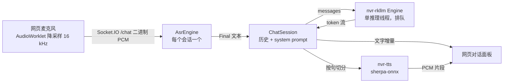

# 板端大模型与语音对话机器人 spec

> Rockchip 构建下，nvr 通过独立 RKLLM worker 提供对话服务（OpenAI 兼容接口），并在后台加一个语音对话机器人：网页麦克风说话 → ASR 识别 → 大模型回复 → TTS 合成语音，文字和语音同时回给网页。

状态：已确认（2026-10-16），按第 8 节分阶段实现；第 1、2 阶段已完成并在 20 主机验收（结果见第 10 节）。默认模型 Qwen3.5-0.8B 纯文本；麦克风采用第 6.3 节的做法 1（nvr 可选 HTTPS 端口）。

## 1. 目标和已经明确的约定

- **新 crate `crates/nvr-rkllm`**：在 lite-nvr 里重新实现 RKLLM 推理，不复制公司仓库 `NVR-APP/3rdparty/rkllm-server` 的代码。它只作为设计参考：dlopen 运行库、渲染全量历史、拆分思考段。
- **进程隔离**（2026-10-26，#3381）：模型在同一 nvr 二进制的内部 `--nvr-rkllm-worker` 模式中加载。主进程管理 worker，不额外部署服务。替代原来的进程内加载，避免 runtime 崩溃中断视频、混音等主服务。
- **只在 `rockchip` feature 下启用**：非 Rockchip 构建不编译 LLM 和对话入口，行为不变。`nvr-rkllm` 本身用 dlopen 加载，不链接厂商库，所以主机也能编译和跑单测。
- **新 crate `crates/nvr-tts`**：基于 sherpa-onnx 的离线 TTS，和 `nvr-asr` 用同一个 `sherpa-onnx` 依赖与原生库。它不依赖 Rockchip，所有构建都能用。
- **语音输入**：后台网页麦克风。**回复输出**：文字流式显示，同时按句合成语音，在网页里播放。
- 不影响现有的采集、转码、录像、检测和 ASR 字幕。

不在本期范围：图文多模态（视觉编码器）、唤醒词与板载麦克风或设备音频输入、从 HDMI 或喇叭播出、多个请求在 NPU 上并发、工具调用。

## 2. 现状

| 项 | 现状 |
| --- | --- |
| NPU 与运行库 | RK3588，RKNPU 驱动 0.9.8；`librkllmrt.so` 1.3.0 不在系统里，放在 `/userdata/rkllm-demo/lib/`（同目录有它依赖的 `libgomp.so.1`） |
| 可用模型 | `Qwen3.5-0.8B_w8a8_rk3588.rkllm`（1.3 GB，ChatML 模板）、`DeepSeek-R1-Distill-Qwen-1.5B_w8a8_g128`（2.2 GB，EOS 转换有误，要额外处理停止 token） |
| 实测性能（1.5B，业务进程在跑） | 加载约 3 s；生成 4.7–5.3 token/s，prefill 约 32 token/s；常驻约 2 GB，大部分是 NPU DMA 缓冲区 |
| 板上内存 | 总 7.5 GB，现在可用约 2.4 GB；外部 rkllm-server（0.8B + 视觉）正占约 1.35 GB |
| ASR | `crates/nvr-asr`：Silero VAD + SenseVoice 离线识别，输入 16 kHz 单声道 f32，输出 `Partial`/`Final`；nvr 里经 Socket.IO `/asr` 推送字幕 |
| TTS | 没有。`sherpa-onnx` 1.13 已提供 `OfflineTts`（VITS、Matcha、Kokoro 等） |
| HTTPS | 没有，后台只走 HTTP 18080 |

## 3. 总体数据流



## 4. `crates/nvr-rkllm`

### 4.1 接口

```rust
pub struct LlmConfig { model, lib, template, max_context_len, max_new_tokens, stop_token_ids, ignore_eos, queue_depth }
pub struct Engine;                       // Clone，内部是到 worker 管理线程的通道
impl Engine {
    pub fn spawn(cfg: LlmConfig) -> Engine;           // 启动独立 worker 加载模型，立即返回（Loading）
    pub async fn wait_ready(&self) -> Result<()>;     // 等加载完成；失败时返回原因
    pub fn generate(&self, req: ChatRequest) -> Result<Generation, Busy>;
    pub fn state(&self) -> EngineState;  // Loading / Ready / Failed(原因)
}
pub struct Generation;                   // Stream<Item = Delta>；drop 即中止
pub enum Delta { Reasoning(String), Content(String), Done { usage, finish_reason } }
```

- `ChatRequest` 包含 messages（system/user/assistant）、`max_tokens`、`temperature`、`top_p`、`top_k`、`repetition_penalty`、`enable_thinking`。
- 模板：`qwen`（ChatML，适用 Qwen2/2.5/3/3.5）和 `deepseek-r1`。`keep_history = 1`，推理线程记住 KV cache 里是哪段对话：新请求如果是在它后面续写（前面的消息原样一致，且上一条 assistant 内容正好是上次生成、以停止 token 或模型自己的 EOS 结束的回复；结束 token 本身不在 KV cache 里），只渲染并 prefill 新消息（先补上一条回复的结束标记）；否则，或预计会超出上下文长度时，`rkllm_clear_kv_cache` 后渲染全量历史。原因是 prefill 很慢（RK3588 上 0.8B 约 30 token/s），每轮重读历史会让首字延迟随轮数增长。被打断或截断的回复不复用。加载后调用 `rkllm_set_chat_template(h, "", "", "")` 关掉 runtime 自带的模板。
- 把 `<think>…</think>` 拆成 `Reasoning`。语音对话默认 `enable_thinking = false`，思考段不进 TTS。
- 命中停止 token 时主动 `rkllm_abort`，`finish_reason = stop`；到 `max_tokens` 时为 `length`。

### 4.2 绑定、线程与进程

- runtime 1.3.0 的 `rkllm.h` 放在 `crates/nvr-rkllm/include/`，`build.rs` 用 bindgen 生成绑定（`--dynamic-loading`，经 `libloading` dlopen `librkllmrt.so`，路径由配置给出）。头文件按 freestanding C 解析（`include/shim/cstdint` 垫片），主机和交叉编译都不需要目标 sysroot；bindgen 生成的编译期断言固定每个结构体的大小和字段偏移。升级 runtime 时替换头文件即可。
- 主进程保留模板、KV cache 的会话元数据和排队逻辑。worker 独占 runtime、模型 handle 和实际 KV cache，串行执行加载、清缓存和推理。管理线程通过继承到 worker 标准输入的私有 Unix socket 发送请求，每个 token 经确认后继续；stdout / stderr 留给厂商日志，避免污染协议。IPC 使用带长度前缀的 JSON，单帧上限 16 MiB。
- nvr 和 demo 的同步入口都先调用 `run_worker_if_requested()`，worker 不初始化 Tokio、数据库或媒体服务。Linux worker 设置父进程退出信号，主进程异常退出也会终止 worker。
- 包内 `start.sh` 只把主进程算作服务实例，排除同路径的 `--nvr-rkllm-worker`。停止时由主进程和父进程退出信号回收 worker，避免把 worker 误认成主服务或重复发信号。
- 排队上限 `queue_depth`，默认 2，超出时返回 `Busy`。HTTP 接口把它映射为 429，对话机器人映射为提示“正在回答别人”。
- 调用方 drop 掉 `Generation` 后，下一个 token 回调触发 `rkllm_abort`。无回调的 prefill / 清缓存给 30 秒取消宽限；超时终止 worker 并设为 `Failed`。发出停止 token 的 abort 后最多等 1 秒。关停直接终止并回收 worker，无需等待下一个 token。

### 4.3 worker 生命周期（runtime 1.3.0 已知问题）

| 问题 | 约束 |
| --- | --- |
| `rkllm_init` 失败路径可能 double free | 文件预检仍保留；dlopen 和 init 仅在 worker 内执行。worker 崩溃 / IPC 断开后状态为 `Failed`，当前及排队请求结束并报错，视频等主服务继续工作。失败后不自动重启，要重启 nvr 才会再次加载 |
| `rkllm_destroy` 偶发卡在 NPU ioctl | 不调用 destroy；主进程终止并 wait 回收 worker，由内核释放模型资源。Linux worker 的错误退出跳过 native 静态析构 |
| 加载或取消卡住 | 模型加载上限 120 秒；取消宽限见上节。关停通过已有 `Engine::shutdown` 等待 worker 回收，沿用 nvr 的 2 秒等待与外层关停超时 |
| 常驻内存约 1.3–2 GB | 默认关闭：没设 `NVR_LLM_MODEL` 时不加载。部署时先停掉板上的外部 rkllm-server，避免同时加载两份模型 |
| runtime 固定使用 A76 大核 4–7 | 与 RKMPP、采集不冲突；推理时会和 ASR、TTS 争 CPU，见第 7 节的测量项 |

### 4.4 nvr 侧接入（`nvr/src/llm/`，`#[cfg(feature = "rockchip")]`）

- 配置（环境变量）：`NVR_LLM_MODEL`（设置了才启用）、`NVR_LLM_LIB`（默认 `librkllmrt.so`）、`NVR_LLM_TEMPLATE`（默认 `qwen`）、`NVR_LLM_MAX_CONTEXT`（4096）、`NVR_LLM_MAX_NEW_TOKENS`（512）、`NVR_LLM_STOP_TOKENS`、`NVR_LLM_IGNORE_EOS`。
- 启动：在 HTTP 服务起来之后，后台加载模型，不阻塞启动；加载期间状态为 `Loading`。
- HTTP 接口挂在 `/api/llm` 下，与其他 `/api` 一样需要鉴权：
  - `POST /api/llm/v1/chat/completions`：OpenAI 兼容，支持非流式和 SSE 流式（`delta.content` / `delta.reasoning_content`，以及 `stream_options.include_usage`）；`stop`、`tools`、`n > 1` 返回 400。
  - `GET /api/llm/v1/models`；`GET /api/llm/health`：`ready` 返回 200，`loading` / `failed` 返回 503 并附原因。

## 5. `crates/nvr-tts`

```rust
pub struct TtsConfig { model_dir, kind /* vits | matcha | kokoro */, speaker_id, speed, num_threads }
pub struct Tts;                                    // Send + Sync，内部持有 OfflineTts
impl Tts {
    pub fn load(cfg: TtsConfig) -> Result<Tts>;
    pub fn synthesize(&self, text: &str) -> Result<Audio>;   // 同步调用，nvr 侧放进 spawn_blocking
}
pub struct Audio { pub samples: Vec<f32>, pub sample_rate: u32 }
pub fn split_sentences(buf: &mut String) -> Vec<String>;      // 从流式文本里切出完整句子
```

- 默认模型 `vits-melo-tts-zh_en`：中英混读，约 160 MB，CPU 推理。和 ASR 一样用 `TTS_MODELS_DIR` 指定目录（默认 `third_party/tts-models`），由 `make download-tts-models` 下载。实测 RTF 不达标时，换 `matcha-icefall-zh-baker`，它更小，但只能读中文。
- 按句合成：LLM 文本流按 `。！？；\n` 以及长逗号句切分，每凑满一句就合成并下发。这样首句语音不用等整段回答生成完。
- 合成前清理不该读出来的内容：Markdown 符号、代码块、表情符号。
- 和 `nvr-asr` 一样提供一个 demo 二进制，例如 `nvr-tts-demo --text ... --out a.wav`，主机和板上都能单独验证。

## 6. 语音对话机器人

### 6.1 后端（`nvr/src/chat/`）

- Socket.IO 新增命名空间 `/chat`，复用现有的 socketioxide 层。连接时用登录 token 鉴权（`io('/chat', { auth: { token } })`，无效则拒绝连接）。连接即创建一个会话，保存对话历史（超过 8 轮或 2000 字时只保留最近一轮：裁掉旧轮会让 LLM 无法续用 KV cache、重新 prefill 全部历史，所以裁得少而狠；被打断的一轮不计入）和 system prompt（`NVR_CHAT_SYSTEM_PROMPT`，默认要求简短口语化、不用 Markdown）。
- 客户端到服务端：
  - `audio`：二进制，16 kHz 单声道 s16le，每片约 100 ms；
  - `start` / `stop`：按住说话的开始和结束；
  - `text`：可选，直接打字提问；ack 回 `{turn}`，即回答这个问题的那一轮（问题为空时为 null）；
  - `reset`：清空历史；`cancel`：打断当前回答。
- 服务端到客户端：
  - `asr_partial` / `asr_final`：识别的中间结果和最终结果（`{text}`）；`asr_final` 另带 `turn`，即回答这句话的那一轮；文本为空表示没听到话，不会开始回答，`turn` 为 null；
  - `reply_delta`：回复文字增量（`{turn, text}`）；
  - `reply_audio`：一句语音（`{turn, seq, sample_rate, pcm}`，`pcm` 为二进制单声道 s16le，`seq` 从 0 起）；
  - `reply_done`（`{turn, interrupted}`）：每一轮都会发，出错时也发；被打断的一轮也发，`interrupted` 为 true；
  - `error`（`{message}`，属于某一轮时带 `turn`）：例如模型未就绪、忙、ASR 不可用。
  - 回答相关事件都带 `turn`；新问题会取消旧的一轮，客户端丢弃旧 `turn` 的语音。turn 编号只由服务端分配，并在这一轮的任何事件之前通过 `text` 的 ack 或 `asr_final` 告诉客户端；客户端不要自己计数。
- 采用**按住说话**，不做全双工：松开时对 ASR 执行 `flush` 得到整句，再发给 LLM。这样避免 TTS 播放的声音被麦克风收进去形成回声，也不需要回声消除。新问题会打断上一轮回答：停止生成，并丢掉还没下发的语音。
- ASR 模型复用现有 ASR 字幕加载的那份，每个会话只新建 VAD，识别跑在会话自己的线程上。TTS 全局只加载一份（`TTS_MODELS_DIR`，默认 `third_party/tts-models`；先试 NPU 的 `MeloTTS-RKNN2`，`librknnrt.so` 路径由 `NVR_TTS_RKNN_LIB` 指定，失败再用 CPU 的 `vits-melo-tts-zh_en`），合成串行执行；连接时就在后台预加载 ASR 和 TTS 模型。加载失败的结果会保留，改好模型后要重启 nvr。
- 关停时先停止新的合成并等待正在进行的那句（最多 2 s），再关 LLM。
- 不用浏览器验证：`e2e/rockchip/chat.py --url http://<板子>:18080 --wav q.wav --rounds 20`（或 `--text`），输出识别结果、回复、松开后首句语音延迟，并把语音存成 WAV。
- LLM 或 TTS 不可用时，对话入口仍然可以打开，并明确提示缺什么。例如没开 LLM 时只返回识别结果，不会卡住。

### 6.2 前端（`nvr-dashboard`）

- 新增“语音对话”页面：按住说话按钮（也支持按空格）、对话气泡（流式显示文字）、语音播放队列（WebAudio 按序号顺序播放）、打断与清空按钮、模型状态（取自 `/api/llm/health`）。
- 麦克风用 `getUserMedia` 和 AudioWorklet 降采样到 16 kHz。请求放在 `src/api/chat.ts`，Socket.IO 用法沿用 `useAsrCaptions` 的写法。

### 6.3 麦克风需要安全上下文

浏览器只在 HTTPS 或 `localhost` 页面里开放 `getUserMedia`。现在访问 `http://<板子>:18080/nvr/`，**麦克风会被浏览器直接禁用**。两种做法：

1. **nvr 增加一个可选的 HTTPS 端口**（例如 `NVR_HTTPS_PORT=18443`）：用 rustls 提供服务，证书没配置时自动生成自签名证书。浏览器首次访问时手动信任一次即可。会新增 `axum-server`（rustls）和 `rcgen` 两个依赖。
2. **不改 nvr**：在使用的电脑上给 Chrome 设置 `--unsafely-treat-insecure-origin-as-secure=http://<板子>:18080`，或者通过 SSH 端口转发，用 `localhost` 访问。

已确定采用 1。2 只作开发调试时的临时办法。

## 7. 验收（20 主机）

| 项 | 方法 | 通过标准 |
| --- | --- | --- |
| FFI 布局 | 主机单测比对 `size_of` 和字段偏移 | 与 g++ 编译 `rkllm.h` 的结果一致 |
| 模板与思考段拆分 | 主机单测 | 多轮、system 消息、流式时思考标签被拆到跨块的情况都正确 |
| 进程内加载 | 设置 `NVR_LLM_MODEL` 启动 nvr | `health` 变为 ready；两路 HDMI 仍是 60 帧、0 丢帧；nvr 内存增量和外部进程模式相当 |
| 加载失败 | 模型路径错误、库路径错误 | nvr 不崩溃；`health` 为 failed 并给出原因；采集和录像照常 |
| OpenAI 接口 | curl 非流式、SSE 流式、并发 5 个请求 | 输出正常；超过排队上限的请求返回 429；客户端断开后生成中止 |
| 关停 | `start.sh stop`，以及在生成过程中 stop | 15 s 内退出，不需要 kill -9 |
| TTS | `nvr-tts-demo`，一段中文 + 英文 | 板上 RTF < 0.5（4 线程），听感可懂 |
| 端到端对话 | 网页按住说话、松开 | 松开后首句语音延迟 < 3 s（0.8B 模型）；连续 20 轮不出错；打断立即生效 |
| 资源 | 对话期间采样 CPU、内存、NPU 和温度 | 采集和录像不丢帧；记录数据写入本文和 `docs/memory/` |

## 8. 分阶段实现

1. **`nvr-rkllm` crate**：FFI、推理线程、模板、思考段拆分、单测；附一个 demo 二进制，在板上单独跑通。
2. **nvr 接入 LLM**：`rockchip` feature、配置、后台加载、`/api/llm` 接口、关停约束；在板上做进程内验收。
3. **`nvr-tts` crate**：sherpa-onnx TTS、分句、文本清理、demo，以及 `make download-tts-models`；在板上测 RTF。
4. **对话后端**：`/chat` 命名空间，把 ASR、LLM、TTS 串起来，支持打断；用一个 Rust 或 Python 脚本代替浏览器发送 WAV 来验证。
5. **前端页面和可选 HTTPS 端口**，以及端到端验收。

每个阶段单独提交，阶段末尾跑 `cargo test`、对照 checklist，并在板上验证。

## 9. 已确认的决定

- 第 6.3 节：nvr 增加可选的 HTTPS 端口，未配置证书时自动生成自签名证书。
- 默认模型：`Qwen3.5-0.8B_w8a8_rk3588.rkllm`，模板 `qwen`，只用纯文本，不加载视觉编码器。
- 板上的外部 `rkllm-demo/rkllm-server`：进程内版本验收通过后再停掉，在那之前两者不同时加载模型。

## 10. 验收记录

### 第 1 阶段：`nvr-rkllm`（2026-10-16，20 主机，runtime 1.3.0）

- `nvr-rkllm-demo` 加载 Qwen3.5-0.8B 约 5.3 s；首个输出约 1.4 s，生成约 6 token/s；多轮对话、停止 token（`finish_reason=stop`）和进程退出正常。
- 手写绑定时 `RKLLMResult` 布局算错（64 字节，实际 72 字节），被布局测试发现；之后改为 bindgen 生成，并由编译期断言固定布局。

### 第 2 阶段：nvr 进程内 LLM（2026-10-16，20 主机）

启动参数：`NVR_LLM_MODEL=/userdata/rkllm-demo/model/Qwen3.5-0.8B_w8a8_rk3588.rkllm`、`NVR_LLM_LIB=/userdata/rkllm-demo/lib/librkllmrt.so`。`librkllmrt.so` 依赖的 `libgomp`、`libstdc++` 由包内 `lib/` 提供。

| 项 | 结果 |
| --- | --- |
| 加载 | 启动后约 4 s 内 `health` 由 `loading` 变为 `ready` |
| 非流式 / 流式 | 非流式 2.6 s 返回，`usage` 正确；SSE 依次为 role、content、finish、usage、`[DONE]` |
| 错误处理 | 空 messages 返回 400；不带 token 返回 401 |
| 并发 | 6 个并发请求：3 个 200、3 个 429（1 个在跑 + 2 个排队） |
| 客户端断开 | 400 token 的流式请求读到第 5 行就断开，下一个请求 7.2 s 返回；不中止的话光生成就要 60 s 以上 |
| 资源 | nvr RSS 约 560 MB → 1.55 GB（增加约 1 GB）；NPU 三核约 17–21%；194 token 用 36 s（约 5.4 token/s） |
| 采集 | 生成期间两路 HDMI 均为 60 帧、0 丢帧，编码约 60 包/s |
| 加载失败 | 模型路径错误：`health` 返回 failed 并给出原因，nvr 和采集照常 |
| 关停 | 生成过程中发 SIGINT，1.25 s 内正常退出，无“仍在生成”警告、无崩溃 |

发现的既有问题（与本功能无关）：nvr 只处理 SIGINT，`start.sh stop` 发出的 SIGTERM 会让进程直接终止，跳过正常关停流程（停止媒体生产者、拆除 ZLM）。

### 第 4 阶段：`/chat` 对话后端（2026-10-19，20 主机）

HEAD `fd4b828` 交叉构建（需求 GLIBC_2.30），只替换原安装目录的 `bin/nvr`（旧版留作 `bin/nvr-before-chat-20261019`）。启动参数在第 2 阶段基础上加 `NVR_TTS_RKNN_LIB=/userdata/rkllm-demo/lib/librknnrt.so`；`third_party/` 下补了 `asr-models`（SenseVoice int8 + silero VAD + 标点）和 `tts-models/MeloTTS-RKNN2`，日志确认 TTS 走 `MeloRknn`（NPU）。外部 `rkllm-server` 仍在运行（两份模型同时常驻）。用 `e2e/rockchip/chat.py` 驱动，问题 WAV 由 `nvr-tts-demo` 合成后转 16 kHz，`--realtime` 按实时速度推送。

| 项 | 结果 |
| --- | --- |
| 链路 | 文字和 WAV 两种输入都跑通：ASR 识别正确（`北京有哪些好玩的地方？`），回复分句合成并回传；松开后 `asr_final` 约 0.01 s 到达 |
| 首句语音延迟（新会话第一轮） | 3.1–5.8 s，**未达 < 3 s**。拆开看：LLM 首字约 1.5–1.8 s，生成第一句（约 27 字）再加 TTS 约 3.5 s |
| 连续 20 轮（同一会话、同一问题） | 20/20 成功、无报错；但 LLM 首字从第 1 轮 1.8 s 逐轮涨到约 11 s，第 9 轮后稳定（历史达到 8 轮上限），首句语音约 14.5 s |
| 首字变慢的原因 | 每轮都把完整历史重新 prefill，而 prefill 只有约 30 token/s：经 `/api/llm` 实测 17 / 113 / 209 / 401 个 prompt token 分别用时 1.47 / 3.75 / 7.25 / 12.81 s；外部 `rkllm-server` 同模型 397 token 用时 12.2 s，可见是 runtime 1.3.0 + Qwen3.5-0.8B 在该板上的特性，与 nvr 实现无关 |
| 打断 | 长回复第一句语音到达时（5.0 s）发新问题：旧 turn 立即不再有 `reply_delta` / `reply_audio`，新 turn 约 3 s 后出第一句语音 |
| 资源（9 分钟，1 Hz 采样） | nvr RSS 1.64 GB → 2.34–2.38 GB（ASR + TTS 约 0.7 GB）；系统 MemAvailable 最低 472 MB；nvr CPU 平均约 3.6 核（启动前约 1.9 核）；NPU core0 峰值 86%；最高温度 66 °C |
| 采集 | 测试前后两路 HDMI 均为 60 帧、`capture_dropped=0`，rkmpp 编码 60 包/s；4 路网络流 25 帧正常 |

待处理：

- 首句延迟受 prefill 制约：要达到 < 3 s，需复用 KV cache（`keep_history=1` 只 prefill 新一轮）或把历史上限压到约 100 token；在此之前，8 轮 / 2000 字的上限会让后几轮等 10 s 以上。（已改为复用 KV cache，见第 4.1 节模板一条和第 6.1 节历史一条，复验见下文）
- 内存余量只有约 0.5 GB：正式使用前应停掉外部 `rkllm-server`（约 1.35 GB）。
- 被打断的 turn 不发 `reply_done`，客户端不要等它。（已改为也发，带 `interrupted: true`）

#### 复验：复用 KV cache 之后（2026-10-19，20 主机）

改动：`nvr-rkllm` 用 `keep_history=1` 并续用 KV cache；`/chat` 历史超限时只留最近一轮；被打断的 turn 发 `reply_done`（`interrupted: true`）。启动参数同上，外部 `rkllm-server` 仍在运行。

| 项 | 结果 |
| --- | --- |
| 续写的 prefill | 每轮只 prefill 新问题的 19 个 token（约 1.5 s），之前要重读全部历史（50–400 token） |
| 连续 20 轮（同一 WAV） | 第 4 轮起 LLM 首字稳定在 1.5–1.6 s，首句语音 2.8–3.2 s（之前第 9 轮后约 11 s / 14.5 s）；第 12、20 轮在裁剪历史后整段重读，首字 3.6–3.8 s |
| 12 个不同问题（同一会话） | 全部完成，无 Markdown，每轮都有语音；首字 1.5–1.9 s（裁剪那轮 3.4 s）；首句语音 2.0–6.5 s，取决于第一句的长度（生成约 4 token/s） |
| 续写是否正确 | `/api/llm` 用 top_k=1 对比：续写和整段 prefill 的回答都连贯、遵守 system prompt，内容略有不同（续写时 KV 里的历史回复多了空 think 段，整段渲染没有） |
| 打断 | 旧 turn 在打断时立即收到 `reply_done`（`interrupted: true`），新 turn 正常结束（`interrupted: false`） |
| 资源 | nvr RSS 最高 2.37 GB，MemAvailable 最低 527 MB，最高温度 67 °C |

仍存在的现象：

- 20 轮测试中，第 1 轮回复在句子中间就以 EOS 结束；第 2 轮续写后模型不再遵守 system prompt，输出了约 480 token 的 Markdown 列表，超过了客户端 120 s 超时。贪心解码的对照测试没有复现，倾向于是 0.8B 模型采样的偶发问题，待继续观察。
- Qwen3.5 的 `<|im_end|>` 是 248046，不在默认停止 token（Qwen2/3 的 151643 / 151645）里；目前靠模型自己的 EOS 结束，行为正确。
- 历史裁剪到只剩一轮后，模型记不起更早的内容（例如问「刚才聊了哪些城市」答不上来）。
- 第一句较长时，首句语音仍超过 3 s。
