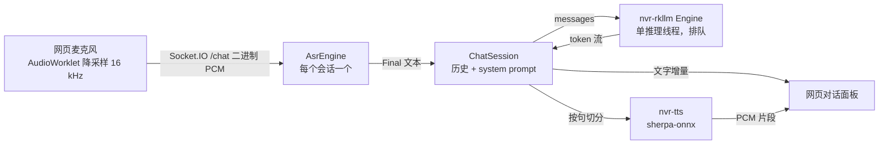

# 板端大模型与语音对话机器人 spec

> Rockchip 构建下，nvr 进程内加载 RKLLM 模型提供对话服务（OpenAI 兼容接口），并在后台加一个语音对话机器人：网页麦克风说话 → ASR 识别 → 大模型回复 → TTS 合成语音，文字和语音同时回给网页。

状态：已确认（2026-10-16），按第 8 节分阶段实现。默认模型 Qwen3.5-0.8B 纯文本；麦克风采用第 6.3 节的做法 1（nvr 可选 HTTPS 端口）。

## 1. 目标和已经明确的约定

- **新 crate `crates/nvr-rkllm`**：在 lite-nvr 里重新实现 RKLLM 推理，不复制公司仓库 `NVR-APP/3rdparty/rkllm-server` 的代码。它只作为设计参考：dlopen 运行库、渲染全量历史、拆分思考段。
- **进程内运行**：模型作为库加载在 nvr 进程里，不另起服务进程。runtime 的已知缺陷由第 4.3 节的约束兜住。
- **只在 `rockchip` feature 下启用**：非 Rockchip 构建不编译 LLM 和对话入口，行为不变。`nvr-rkllm` 本身用 dlopen 加载，不链接厂商库，所以主机也能编译和跑单测。
- **新 crate `crates/nvr-tts`**：基于 sherpa-onnx 的离线 TTS，和 `nvr-asr` 用同一个 `sherpa-onnx` 依赖与原生库。它不依赖 Rockchip，所有构建都能用。
- **语音输入**：后台网页麦克风。**回复输出**：文字流式显示，同时按句合成语音，在网页里播放。
- 不影响现有的采集、转码、录像、检测和 ASR 字幕。

不在本期范围：图文多模态（视觉编码器）、唤醒词与板载麦克风或设备音频输入、从 HDMI 或喇叭播出、多个请求在 NPU 上并发、工具调用。

## 2. 现状

| 项 | 现状 |
| --- | --- |
| NPU 与运行库 | RK3588，RKNPU 驱动 0.9.8；`librkllmrt.so` 1.3.0 不在系统里，放在 `/userdata/rkllm-demo/lib/`（同目录有它依赖的 `libgomp.so.1`） |
| 可用模型 | `Qwen3.5-0.8B_w8a8_rk3588.rkllm`（1.3 GB，ChatML 模板）、`DeepSeek-R1-Distill-Qwen-1.5B_w8a8_g128`（2.2 GB，EOS 转换有误，要额外处理停止 token） |
| 实测性能（1.5B，业务进程在跑） | 加载约 3 s；生成 4.7–5.3 token/s，prefill 约 32 token/s；常驻约 2 GB，大部分是 NPU DMA 缓冲区 |
| 板上内存 | 总 7.5 GB，现在可用约 2.4 GB；外部 rkllm-server（0.8B + 视觉）正占约 1.35 GB |
| ASR | `crates/nvr-asr`：Silero VAD + SenseVoice 离线识别，输入 16 kHz 单声道 f32，输出 `Partial`/`Final`；nvr 里经 Socket.IO `/asr` 推送字幕 |
| TTS | 没有。`sherpa-onnx` 1.13 已提供 `OfflineTts`（VITS、Matcha、Kokoro 等） |
| HTTPS | 没有，后台只走 HTTP 18080 |

## 3. 总体数据流



## 4. `crates/nvr-rkllm`

### 4.1 接口

```rust
pub struct LlmConfig { model, lib, template, max_context_len, max_new_tokens, stop_token_ids, ignore_eos, queue_depth }
pub struct Engine;                       // Clone，内部是到推理线程的通道
impl Engine {
    pub fn spawn(cfg: LlmConfig) -> Engine;           // 起推理线程并在其上加载模型，立即返回（Loading）
    pub async fn wait_ready(&self) -> Result<()>;     // 等加载完成；失败时返回原因
    pub fn generate(&self, req: ChatRequest) -> Result<Generation, Busy>;
    pub fn state(&self) -> EngineState;  // Loading / Ready / Failed(原因)
}
pub struct Generation;                   // Stream<Item = Delta>；drop 即中止
pub enum Delta { Reasoning(String), Content(String), Done { usage, finish_reason } }
```

- `ChatRequest` 包含 messages（system/user/assistant）、`max_tokens`、`temperature`、`top_p`、`top_k`、`repetition_penalty`、`enable_thinking`。
- 模板：`qwen`（ChatML，适用 Qwen2/2.5/3/3.5）和 `deepseek-r1`。每次请求渲染全量历史，`keep_history = 0`；加载后调用 `rkllm_set_chat_template(h, "", "", "")` 关掉 runtime 自带的模板。
- 把 `<think>…</think>` 拆成 `Reasoning`。语音对话默认 `enable_thinking = false`，思考段不进 TTS。
- 命中停止 token 时主动 `rkllm_abort`，`finish_reason = stop`；到 `max_tokens` 时为 `length`。

### 4.2 绑定与线程

- runtime 1.3.0 的 `rkllm.h` 放在 `crates/nvr-rkllm/include/`，`build.rs` 用 bindgen 生成绑定（`--dynamic-loading`，经 `libloading` dlopen `librkllmrt.so`，路径由配置给出）。头文件按 freestanding C 解析（`include/shim/cstdint` 垫片），主机和交叉编译都不需要目标 sysroot；bindgen 生成的编译期断言固定每个结构体的大小和字段偏移。升级 runtime 时替换头文件即可。
- 只有一个专用推理线程。它持有 handle，串行处理请求，所以 NPU 同一时刻只跑一个生成任务。`rkllm_run` 的回调通过有界通道把 token 交出去。
- 排队上限 `queue_depth`，默认 2，超出时返回 `Busy`。HTTP 接口把它映射为 429，对话机器人映射为提示“正在回答别人”。
- 调用方 drop 掉 `Generation` 后，推理线程在下一个回调返回非 0，或调用 `rkllm_abort` 中止，不会继续占用 NPU。

### 4.3 进程内运行的约束（runtime 1.3.0 已知问题）

| 问题 | 约束 |
| --- | --- |
| `rkllm_init` 失败路径可能 double free，导致整个 nvr 崩溃 | init 前先检查：模型文件存在、可读、大小大于 0，扩展名为 `.rkllm`；运行库能 dlopen，所需符号齐全。只在启动时 init 一次；失败就记录为 `Failed`，**本进程内不重试**，要重启 nvr 才会再试 |
| `rkllm_destroy` 偶发卡在 NPU ioctl | 关停时只 abort 当前生成，**不调用 destroy**；推理线程分离，进程退出后由内核回收 NPU 内存。退出时会打印几条 `E RKNN: can not find memory for freeing`，属于预期 |
| 常驻内存约 1.3–2 GB | 默认关闭：没设 `NVR_LLM_MODEL` 时不加载。部署时先停掉板上的外部 rkllm-server，避免同时加载两份模型 |
| runtime 固定使用 A76 大核 4–7 | 与 RKMPP、采集不冲突；推理时会和 ASR、TTS 争 CPU，见第 7 节的测量项 |

### 4.4 nvr 侧接入（`nvr/src/llm/`，`#[cfg(feature = "rockchip")]`）

- 配置（环境变量）：`NVR_LLM_MODEL`（设置了才启用）、`NVR_LLM_LIB`（默认 `librkllmrt.so`）、`NVR_LLM_TEMPLATE`（默认 `qwen`）、`NVR_LLM_MAX_CONTEXT`（4096）、`NVR_LLM_MAX_NEW_TOKENS`（512）、`NVR_LLM_STOP_TOKENS`、`NVR_LLM_IGNORE_EOS`。
- 启动：在 HTTP 服务起来之后，后台加载模型，不阻塞启动；加载期间状态为 `Loading`。
- HTTP 接口挂在 `/api/llm` 下，与其他 `/api` 一样需要鉴权：
  - `POST /api/llm/v1/chat/completions`：OpenAI 兼容，支持非流式和 SSE 流式（`delta.content` / `delta.reasoning_content`，以及 `stream_options.include_usage`）；`stop`、`tools`、`n > 1` 返回 400。
  - `GET /api/llm/v1/models`；`GET /api/llm/health`：`ready` 返回 200，`loading` / `failed` 返回 503 并附原因。

## 5. `crates/nvr-tts`

```rust
pub struct TtsConfig { model_dir, kind /* vits | matcha | kokoro */, speaker_id, speed, num_threads }
pub struct Tts;                                    // Send + Sync，内部持有 OfflineTts
impl Tts {
    pub fn load(cfg: TtsConfig) -> Result<Tts>;
    pub fn synthesize(&self, text: &str) -> Result<Audio>;   // 同步调用，nvr 侧放进 spawn_blocking
}
pub struct Audio { pub samples: Vec<f32>, pub sample_rate: u32 }
pub fn split_sentences(buf: &mut String) -> Vec<String>;      // 从流式文本里切出完整句子
```

- 默认模型 `vits-melo-tts-zh_en`：中英混读，约 160 MB，CPU 推理。和 ASR 一样用 `TTS_MODELS_DIR` 指定目录（默认 `third_party/tts-models`），由 `make download-tts-models` 下载。实测 RTF 不达标时，换 `matcha-icefall-zh-baker`，它更小，但只能读中文。
- 按句合成：LLM 文本流按 `。！？；\n` 以及长逗号句切分，每凑满一句就合成并下发。这样首句语音不用等整段回答生成完。
- 合成前清理不该读出来的内容：Markdown 符号、代码块、表情符号。
- 和 `nvr-asr` 一样提供一个 demo 二进制，例如 `nvr-tts-demo --text ... --out a.wav`，主机和板上都能单独验证。

## 6. 语音对话机器人

### 6.1 后端（`nvr/src/chat/`）

- Socket.IO 新增命名空间 `/chat`，复用现有的 socketioxide 层。连接即创建一个会话，保存对话历史（最多保留最近 N 轮，并受上下文长度限制）和 system prompt。
- 客户端到服务端：
  - `audio`：二进制，16 kHz 单声道 f32le 或 s16le，每片约 100 ms；
  - `start` / `stop`：按住说话的开始和结束；
  - `text`：可选，直接打字提问；
  - `reset`：清空历史；`cancel`：打断当前回答。
- 服务端到客户端：
  - `asr_partial` / `asr_final`：识别的中间结果和最终结果；
  - `reply_delta`：回复文字增量；
  - `reply_audio`：一句语音，带序号、采样率和 PCM 数据；
  - `reply_done`；
  - `error`：例如模型未就绪、忙、ASR 不可用。
- 采用**按住说话**，不做全双工：松开时对 ASR 执行 `flush` 得到整句，再发给 LLM。这样避免 TTS 播放的声音被麦克风收进去形成回声，也不需要回声消除。新问题会打断上一轮回答：停止生成，并丢掉还没下发的语音。
- ASR 模型复用现有 ASR 字幕加载的那份，每个会话只新建 VAD。TTS 全局只加载一份，合成串行执行。
- LLM 或 TTS 不可用时，对话入口仍然可以打开，并明确提示缺什么。例如没开 LLM 时只返回识别结果，不会卡住。

### 6.2 前端（`nvr-dashboard`）

- 新增“语音对话”页面：按住说话按钮（也支持按空格）、对话气泡（流式显示文字）、语音播放队列（WebAudio 按序号顺序播放）、打断与清空按钮、模型状态（取自 `/api/llm/health`）。
- 麦克风用 `getUserMedia` 和 AudioWorklet 降采样到 16 kHz。请求放在 `src/api/chat.ts`，Socket.IO 用法沿用 `useAsrCaptions` 的写法。

### 6.3 麦克风需要安全上下文

浏览器只在 HTTPS 或 `localhost` 页面里开放 `getUserMedia`。现在访问 `http://<板子>:18080/nvr/`，**麦克风会被浏览器直接禁用**。两种做法：

1. **nvr 增加一个可选的 HTTPS 端口**（例如 `NVR_HTTPS_PORT=18443`）：用 rustls 提供服务，证书没配置时自动生成自签名证书。浏览器首次访问时手动信任一次即可。会新增 `axum-server`（rustls）和 `rcgen` 两个依赖。
2. **不改 nvr**：在使用的电脑上给 Chrome 设置 `--unsafely-treat-insecure-origin-as-secure=http://<板子>:18080`，或者通过 SSH 端口转发，用 `localhost` 访问。

已确定采用 1。2 只作开发调试时的临时办法。

## 7. 验收（20 主机）

| 项 | 方法 | 通过标准 |
| --- | --- | --- |
| FFI 布局 | 主机单测比对 `size_of` 和字段偏移 | 与 g++ 编译 `rkllm.h` 的结果一致 |
| 模板与思考段拆分 | 主机单测 | 多轮、system 消息、流式时思考标签被拆到跨块的情况都正确 |
| 进程内加载 | 设置 `NVR_LLM_MODEL` 启动 nvr | `health` 变为 ready；两路 HDMI 仍是 60 帧、0 丢帧；nvr 内存增量和外部进程模式相当 |
| 加载失败 | 模型路径错误、库路径错误 | nvr 不崩溃；`health` 为 failed 并给出原因；采集和录像照常 |
| OpenAI 接口 | curl 非流式、SSE 流式、并发 5 个请求 | 输出正常；超过排队上限的请求返回 429；客户端断开后生成中止 |
| 关停 | `start.sh stop`，以及在生成过程中 stop | 15 s 内退出，不需要 kill -9 |
| TTS | `nvr-tts-demo`，一段中文 + 英文 | 板上 RTF < 0.5（4 线程），听感可懂 |
| 端到端对话 | 网页按住说话、松开 | 松开后首句语音延迟 < 3 s（0.8B 模型）；连续 20 轮不出错；打断立即生效 |
| 资源 | 对话期间采样 CPU、内存、NPU 和温度 | 采集和录像不丢帧；记录数据写入本文和 `docs/memory/` |

## 8. 分阶段实现

1. **`nvr-rkllm` crate**：FFI、推理线程、模板、思考段拆分、单测；附一个 demo 二进制，在板上单独跑通。
2. **nvr 接入 LLM**：`rockchip` feature、配置、后台加载、`/api/llm` 接口、关停约束；在板上做进程内验收。
3. **`nvr-tts` crate**：sherpa-onnx TTS、分句、文本清理、demo，以及 `make download-tts-models`；在板上测 RTF。
4. **对话后端**：`/chat` 命名空间，把 ASR、LLM、TTS 串起来，支持打断；用一个 Rust 或 Python 脚本代替浏览器发送 WAV 来验证。
5. **前端页面和可选 HTTPS 端口**，以及端到端验收。

每个阶段单独提交，阶段末尾跑 `cargo test`、对照 checklist，并在板上验证。

## 9. 已确认的决定

- 第 6.3 节：nvr 增加可选的 HTTPS 端口，未配置证书时自动生成自签名证书。
- 默认模型：`Qwen3.5-0.8B_w8a8_rk3588.rkllm`，模板 `qwen`，只用纯文本，不加载视觉编码器。
- 板上的外部 `rkllm-demo/rkllm-server`：进程内版本验收通过后再停掉，在那之前两者不同时加载模型。
